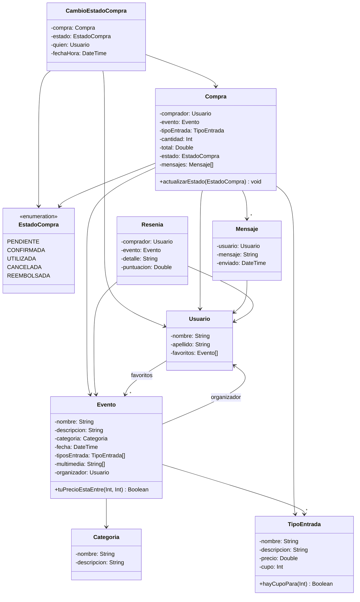

# Diagrama de Clases del Dominio (`AI Ticket It`)

Este documento es la referencia estructurada y legible por agentes de IA del **Diagrama Tentativo** oficial del enunciado. La imagen original también se encuentra respaldada en `docs/diagrama-tentativo-original.png`.

---

## 1. Réplica Exacta del Diagrama Tentativo (Mermaid)

---

## 2. Diccionario Detallado de Clases, Atributos y Métodos

| Clase / Enum | Tipo | Atributos (del Diagrama) | Métodos (del Diagrama) | Relaciones Salientes |
| :--- | :--- | :--- | :--- | :--- |
| **`Usuario`** | Clase (`C`) | `- nombre: String` `- apellido: String` `- favoritos: Evento[]` | *(Métodos de gestión de favoritos en implementación)* | `--> "*" Evento` (`favoritos`) |
| **`Categoria`** | Clase (`C`) | `- nombre: String` `- descripcion: String` | — | — |
| **`TipoEntrada`** | Clase (`C`) | `- nombre: String` `- descripcion: String` `- precio: Double` `- cupo: Int` | `+ hayCupoPara(Int): Boolean` | — |
| **`Evento`** | Clase (`C`) | `- nombre: String` `- descripcion: String` `- categoria: Categoria` `- fecha: DateTime` `- tiposEntrada: TipoEntrada[]` `- multimedia: String[]` `- organizador: Usuario` | `+ tuPrecioEstaEntre(Int, Int): Boolean` | `--> Usuario` (`organizador`) `--> Categoria` `--> "*" TipoEntrada` |
| **`Compra`** | Clase (`C`) | `- comprador: Usuario` `- evento: Evento` `- tipoEntrada: TipoEntrada` `- cantidad: Int` `- total: Double` `- estado: EstadoCompra` `- mensajes: Mensaje[]` | `+ actualizarEstado(EstadoCompra): void` | `--> Usuario` (`comprador`) `--> Evento` `--> TipoEntrada` `--> EstadoCompra` `--> "*" Mensaje` |
| **`EstadoCompra`** | Enum (`E`) | `PENDIENTE` `CONFIRMADA` `UTILIZADA` `CANCELADA` `REEMBOLSADA` | — | — |
| **`CambioEstadoCompra`** | Clase (`C`) | `- compra: Compra` `- estado: EstadoCompra` `- quien: Usuario` `- fechaHora: DateTime` | — | `--> Compra` `--> EstadoCompra` `--> Usuario` (`quien`) |
| **`Mensaje`** | Clase (`C`) | `- usuario: Usuario` `- mensaje: String` `- enviado: DateTime` | — | `--> Usuario` |
| **`Resenia`** | Clase (`C`) | `- comprador: Usuario` `- evento: Evento` `- detalle: String` `- puntuacion: Double` | — | `--> Usuario` (`comprador`) `--> Evento` |

