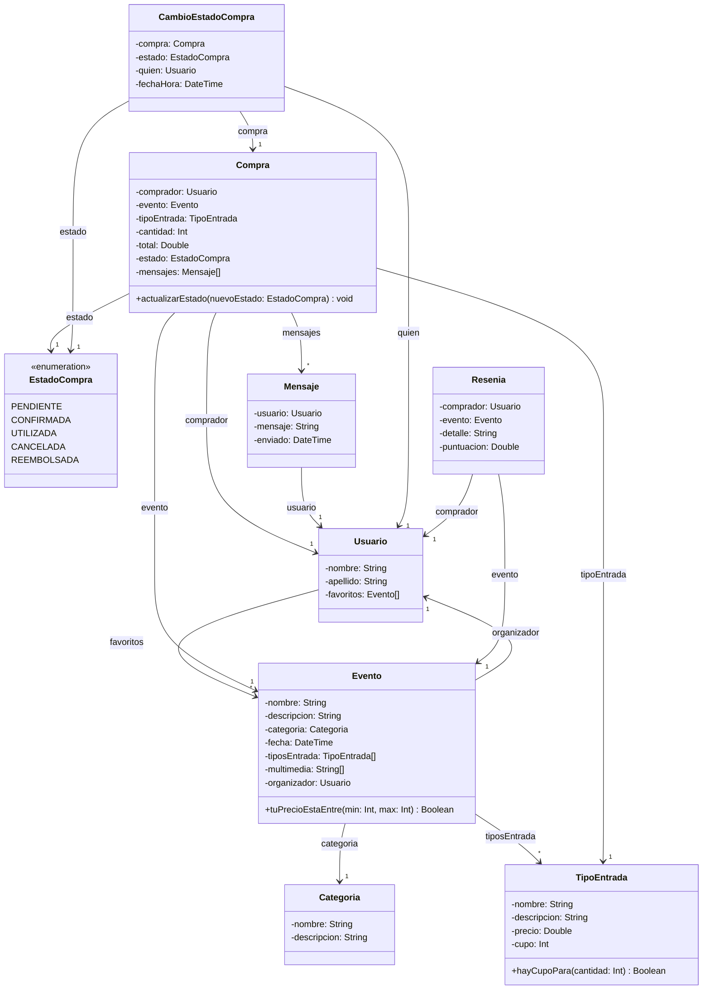

# AI Ticket It — Plataforma de Venta de Entradas para Eventos

> Trabajo Práctico Individual de Desarrollo con Inteligencia Artificial (-2C 2026-)

---

## 1. Objetivo del Trabajo

El objetivo de este trabajo práctico es brindar a los estudiantes un espacio de experimentación intensiva con herramientas de Inteligencia Artificial aplicadas al desarrollo de software.

Actualmente, el uso de IA se ha convertido en un factor clave para potenciar la productividad, acelerar ciclos de desarrollo y asistir en la resolución de problemas técnicos complejos. Sin embargo, también resulta fundamental comprender las implicancias de depender excesivamente de estas herramientas sin un adecuado criterio técnico. Por este motivo, el presente trabajo propone explorar el uso de Inteligencia Artificial como herramienta principal de desarrollo, promoviendo su utilización de manera intensiva pero consciente.

---

## 2. Contexto General

**AI Ticket It** es una plataforma orientada a la publicación de eventos y la venta de entradas que conecta a **organizadores** y **compradores**:

- **Organizadores**: Pueden crear y gestionar sus eventos, incluyendo descripciones detalladas, fecha de realización, categoría, material multimedia y distintos tipos de entrada según ubicación/tipo (ej. General, Platea, VIP), precio y cupo disponible, además de administrar las ventas realizadas.
- **Compradores**: Pueden navegar el catálogo de eventos, buscar espectáculos mediante una barra de búsqueda textual, filtrar por categorías, ordenar por precio, fecha del evento y puntaje del organizador, guardar eventos favoritos y comprar entradas sin superar el cupo disponible.
- **Seguimiento y Estados de Compra**: Las compras atraviesan distintas etapas (`PENDIENTE`, `CONFIRMADA`, `UTILIZADA`, `CANCELADA`, `REEMBOLSADA`), registrando el historial de cambios de estado (`CambioEstadoCompra`).
- **Comunicación (Chat por Compra)**: Cada compra cuenta con un espacio de comunicación simple donde comprador y organizador pueden intercambiar mensajes (`Mensaje`) en cualquier momento.
- **Calificaciones y Reseñas**: Una vez utilizada una entrada (`UTILIZADA`), el comprador puede calificar el evento mediante un puntaje numérico y un comentario escrito (`Resenia`), permitiendo visualizar las reseñas de eventos anteriores en los eventos de cada organizador.

---

## 3. Diagrama de Dominio Tentativo

---

## 4. Requerimientos Técnicos

- **Módulo Back-End**: Desarrollado utilizando **Node.js + Express**.
- **Módulo Front-End**: Desarrollado utilizando **React Native**.
- **Ejecución y Persistencia**: La aplicación deberá ejecutarse de forma **local en un dispositivo mobile** y utilizar un mecanismo de **persistencia en memoria** para el almacenamiento de datos.

---

## 5. Casos de Uso Requeridos

1. **Visualizar compras (Comprador)**: Como comprador, quiero poder visualizar mis compras, diferenciando con claridad el estado en el que se encuentran y cuántos días faltan para el evento en caso de estar en estado **confirmada**.
2. **Visualizar ventas y disponibilidad (Organizador)**: Como organizador, quiero poder visualizar las compras asociadas a un Evento en particular, diferenciando con claridad el estado en el que se encuentran y cuántas entradas quedan disponibles de cada tipo.
3. **Buscar y filtrar eventos (Comprador)**: Como comprador, quiero poder buscar Eventos de forma específica mediante una búsqueda textual o explorarlos por categorías.
4. **Crear evento con tipos de entrada (Organizador)**: Como organizador, quiero poder crear un Evento ofreciendo distintos tipos de entrada, cada uno con su precio y cupo, permitiendo adaptarse a diferentes públicos y presupuestos.
5. **Enviar mensajes en compra (Comprador)**: Como comprador, quiero poder enviar mensajes en cualquier momento relacionados a una compra mediante un chat dentro de la misma.
6. **Responder mensajes en compra (Organizador)**: Como organizador, quiero poder responder mensajes en cualquier momento relacionados a una compra mediante un chat dentro de la misma.
7. **Cancelar compra y reembolso (Comprador)**: Como comprador, quiero poder cancelar una compra para obtener el reembolso en caso de no poder asistir al evento.
8. **Regla de negocio de cancelación (Organizador)**: Como organizador, quiero que los compradores puedan cancelar una compra siempre que la misma no se encuentre en estado **utilizada** y el evento aún no se haya realizado.
9. **Calificar evento (Organizador/Comprador)**: Como organizador, quiero que una vez **utilizada** una entrada el comprador pueda puntuar el Evento de forma numérica y dejar un comentario escrito.
10. **Visualizar reseñas del organizador (Comprador)**: Como comprador, quiero que las reseñas de eventos anteriores se visualicen en los Eventos de cada organizador para conocer experiencias previas antes de comprar.
11. **Ordenamiento de eventos (Comprador)**: Como comprador, al buscar Eventos, quiero poder ordenarlos por **precio**, **fecha del evento** y **puntaje del organizador**.
12. **Realizar compra con control de cupo (Comprador)**: Como comprador, quiero poder realizar una compra sobre un Evento seleccionando uno de los tipos de entrada disponibles y la cantidad deseada, sin superar el cupo disponible.

---

## 6. Requisitos de Entrega

- **Video de 5 a 10 minutos**: Demostración técnica completa enfocada en uno de los flujos funcionales implementados:
  1. Implementación del flujo en el **Back-End**.
  2. Implementación del flujo en el **Front-End**.
  3. Recorrido completo del flujo dentro de la **interfaz gráfica** de la aplicación.
- **Conclusión final**: Reflexión sobre el proceso de desarrollo utilizando herramientas de IA (ventajas, desventajas, dificultades encontradas, aprendizajes obtenidos y valoración personal sobre productividad y calidad).

