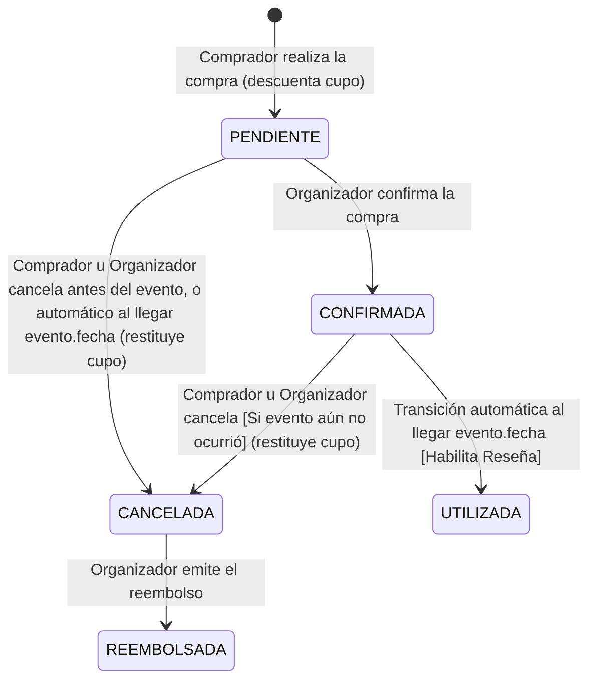

# Especificación de Dominio 02: Máquina de Estados de `Compra`

## 1. Propósito

Especificar las reglas de transición entre los valores de `EstadoCompra`, su impacto sobre `CambioEstadoCompra`, el cupo de `TipoEntrada` y la habilitación de `Resenia`.

---

## 2. Diagrama de Estados (`EstadoCompra`)

---

## 3. Matriz de Transiciones Válidas en `Compra.actualizarEstado`

| Estado Actual | Estados Destino Permitidos | Quién dispara la acción | Estados Destino Prohibidos (`InvalidStateTransitionError`) |
| :--- | :--- | :--- | :--- |
| **`PENDIENTE`** | `CONFIRMADA`, `CANCELADA` | Organizador (`CONFIRMADA`) / Comprador, Organizador o Automático al cumplirse `evento.fecha` (`CANCELADA`) | `PENDIENTE`, `UTILIZADA`, `REEMBOLSADA` |
| **`CONFIRMADA`** | `UTILIZADA`, `CANCELADA` | Automático al cumplirse `evento.fecha` (`UTILIZADA` vía `sincronizarEstadoPorFecha`) / Comprador u Organizador (`CANCELADA` antes del evento) | `PENDIENTE`, `CONFIRMADA`, `REEMBOLSADA` |
| **`UTILIZADA`** | *(Estado terminal)* | — | Todos (`PENDIENTE`, `CONFIRMADA`, `UTILIZADA`, `CANCELADA`, `REEMBOLSADA`) |
| **`CANCELADA`** | `REEMBOLSADA` | Organizador (`REEMBOLSADA`) | `PENDIENTE`, `CONFIRMADA`, `UTILIZADA`, `CANCELADA` |
| **`REEMBOLSADA`** | *(Estado terminal)* | — | Todos (`PENDIENTE`, `CONFIRMADA`, `UTILIZADA`, `CANCELADA`, `REEMBOLSADA`) |

---

## 4. Reglas de Negocio Asociadas a los Estados

1. **Creación de la Compra (`PENDIENTE`)**:
   - Toda nueva compra nace en `EstadoCompra.PENDIENTE`, reservando/descontando inmediatamente la `cantidad` del `cupo` disponible en `TipoEntrada` y registrando el `CambioEstadoCompra` inicial.
2. **Confirmación de la Compra (`PENDIENTE` → `CONFIRMADA`)**:
   - El organizador confirma la compra y pasa a `CONFIRMADA`.
3. **Transiciones automáticas al llegar `evento.fecha` (`sincronizarEstadoPorFecha`)**:
   - Cuando `evento.yaOcurrio(ahora)` (`evento.fecha <= ahora`):
     - Si `compra.estado === EstadoCompra.CONFIRMADA`, pasa automáticamente a **`UTILIZADA`** (sin acción manual desde el panel ni por `PATCH /api/compras/:id/estado`), registrando el `CambioEstadoCompra` con la fecha del evento.
     - Si `compra.estado === EstadoCompra.PENDIENTE`, se cancela automáticamente pasando a **`CANCELADA`**, restituyendo el cupo al `TipoEntrada` y registrando el `CambioEstadoCompra` con la fecha del evento (evitando compras pendientes bloqueadas tras ocurrir el evento).
4. **Días faltantes para el evento (Caso de Uso 1)**:
   - Solo se informan cuando `compra.estado === EstadoCompra.CONFIRMADA`.
   - En estados `PENDIENTE`, `UTILIZADA`, `CANCELADA` o `REEMBOLSADA`, `calcularDiasParaEvento()` devuelve `null`.
5. **Cancelación por el Comprador o el Organizador (Casos de Uso 7 y 8 — `PENDIENTE`/`CONFIRMADA` → `CANCELADA`)**:
   - Condición 1: `compra.estado` puede ser `PENDIENTE` o `CONFIRMADA`; NO puede ser `UTILIZADA` (ni estar ya `CANCELADA` o `REEMBOLSADA`). Si lo está, se rechaza con `InvalidStateTransitionError`.
   - Condición 2: La fecha del `Evento` debe ser estrictamente posterior a la fecha/hora actual (`evento.fecha > ahora`). Si el evento ya se realizó (`evento.fecha <= ahora`), se rechaza con `DomainValidationError("No se puede cancelar una compra de un evento que ya se realizó")`.
   - Autorización: pueden cancelar tanto el **comprador** de la compra como el **organizador** del evento.
   - Efecto: La compra pasa a estado **`CANCELADA`**, registra el `CambioEstadoCompra` con `quien` igual al usuario que ejecutó la acción y ejecuta `tipoEntrada.restituirCupo(compra.cantidad)`.
6. **Reembolso por el Organizador (`CANCELADA` → `REEMBOLSADA`)**:
   - Cuando una compra se encuentra en estado `CANCELADA`, el organizador puede reembolsarla mediante el botón correspondiente, pasando la compra a **`REEMBOLSADA`** y registrando el `CambioEstadoCompra`.
7. **Calificación / Reseña de Evento (Caso de Uso 9)**:
   - Un comprador solo puede registrar una `Resenia` sobre un `Evento` si posee una `Compra` para dicho evento con `estado === EstadoCompra.UTILIZADA`.
