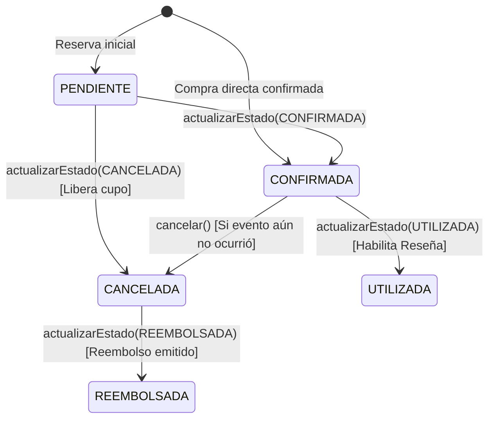

# Especificación de Dominio 02: Máquina de Estados de `Compra`

## 1. Propósito

Especificar las reglas de transición entre los valores de `EstadoCompra`, su impacto sobre `CambioEstadoCompra`, el cupo de `TipoEntrada` y la habilitación de `Resenia`.

---

## 2. Diagrama de Estados (`EstadoCompra`)

---

## 3. Matriz de Transiciones Válidas en `Compra.actualizarEstado`

| Estado Actual | Estados Destino Permitidos | Estados Destino Prohibidos (`InvalidStateTransitionError`) |
| :--- | :--- | :--- |
| **`PENDIENTE`** | `CONFIRMADA`, `CANCELADA` | `PENDIENTE`, `UTILIZADA`, `REEMBOLSADA` |
| **`CONFIRMADA`** | `UTILIZADA`, `CANCELADA` | `PENDIENTE`, `CONFIRMADA`, `REEMBOLSADA` |
| **`UTILIZADA`** | *(Estado terminal)* | Todos (`PENDIENTE`, `CONFIRMADA`, `UTILIZADA`, `CANCELADA`, `REEMBOLSADA`) |
| **`CANCELADA`** | `REEMBOLSADA` | `PENDIENTE`, `CONFIRMADA`, `UTILIZADA`, `CANCELADA` |
| **`REEMBOLSADA`** | *(Estado terminal)* | Todos (`PENDIENTE`, `CONFIRMADA`, `UTILIZADA`, `CANCELADA`, `REEMBOLSADA`) |

---

## 4. Reglas de Negocio Asociadas a los Estados

1. **Días faltantes para el evento (Caso de Uso 1)**:
   - Solo se informan cuando `compra.estado === EstadoCompra.CONFIRMADA`.
   - En estados `PENDIENTE`, `UTILIZADA`, `CANCELADA` o `REEMBOLSADA`, `calcularDiasParaEvento()` devuelve `null`.
2. **Cancelación y Reembolso (Casos de Uso 7 y 8)**:
   - Condición 1: `compra.estado` NO puede ser `UTILIZADA` (ni estar ya `CANCELADA` o `REEMBOLSADA`). Si lo está, se rechaza con `InvalidStateTransitionError`.
   - Condición 2: La fecha del `Evento` debe ser estrictamente posterior a la fecha/hora actual (`evento.fecha > ahora`). Si el evento ya se realizó (`evento.fecha <= ahora`), se rechaza con `DomainValidationError("No se puede cancelar una compra de un evento que ya se realizó")`.
   - Efecto:
     - Si estaba `CONFIRMADA`: transiciona a `CANCELADA` y luego a `REEMBOLSADA`, registrando los `CambioEstadoCompra` y ejecutando `tipoEntrada.restituirCupo(compra.cantidad)`.
     - Si estaba `PENDIENTE`: transiciona a `CANCELADA`, registrando el `CambioEstadoCompra` y ejecutando `tipoEntrada.restituirCupo(compra.cantidad)`.
3. **Calificación / Reseña de Evento (Caso de Uso 9)**:
   - Un comprador solo puede registrar una `Resenia` sobre un `Evento` si posee una `Compra` para dicho evento con `estado === EstadoCompra.UTILIZADA`.

